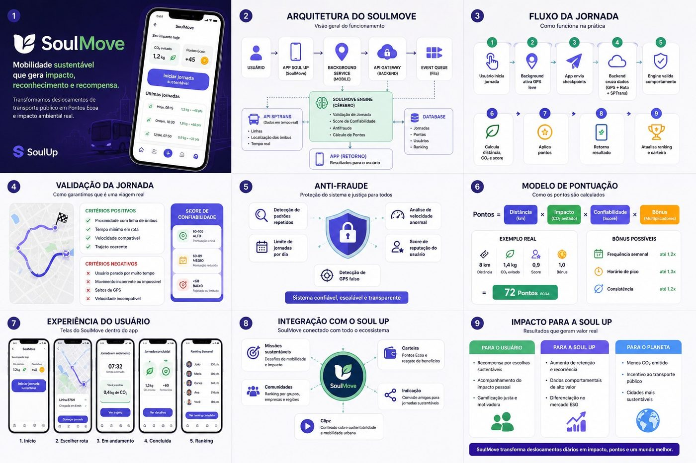
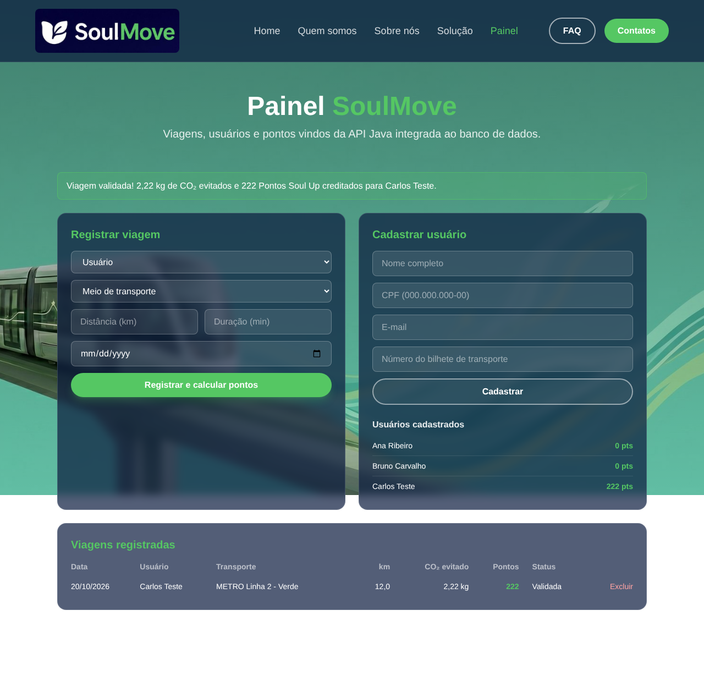
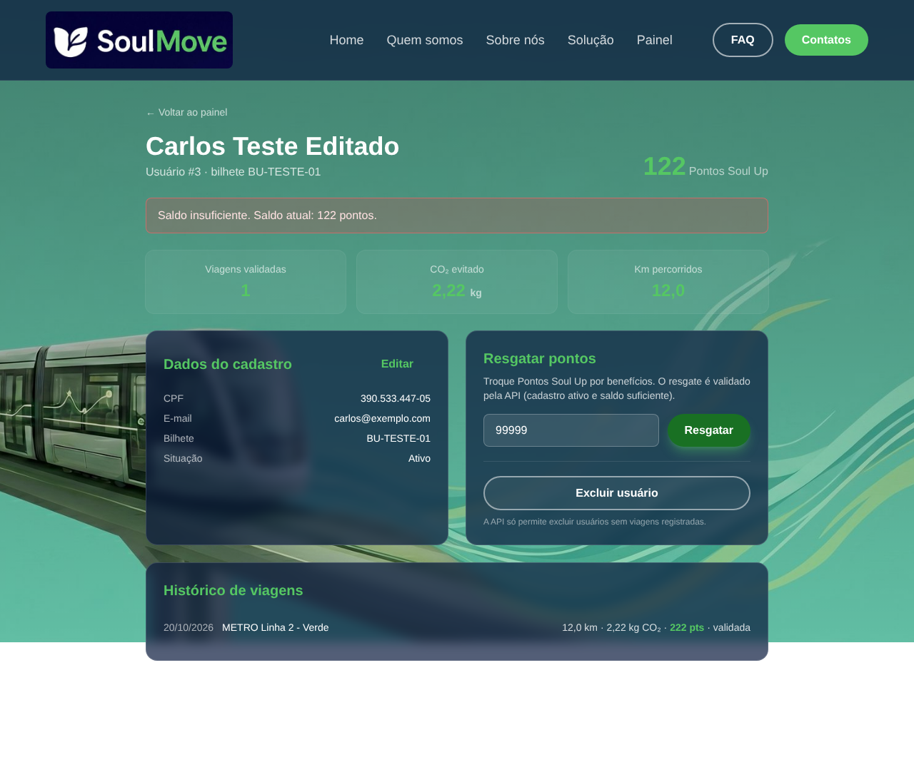
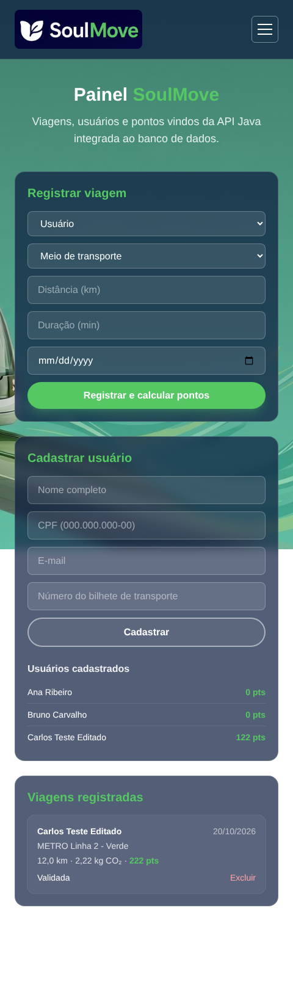

# 🚌 SoulMove — Sprint 04 | Front-End Design Engineering (FIAP)

<div align="center">
  
  <h3>Mobilidade sustentável que gera impacto, reconhecimento e recompensa 🌱</h3>
</div>

---

## 📋 Descrição do Projeto

O **SoulMove** é a solução do grupo **Un-glitch Tech** para o **Challenge Soul Up (FIAP 2026)**. O usuário registra viagens de transporte público (ônibus e metrô), o sistema valida o trajeto, calcula o CO₂ evitado em relação ao carro e converte o impacto em **Pontos Soul Up**, que podem ser resgatados por benefícios.

Na **Sprint 04** o site (React + Vite + TypeScript, SPA com React Router e Tailwind CSS) foi integrado à **API REST em Java/Spring Boot** desenvolvida na disciplina *Domain Driven Design using Java*. As páginas **Painel** e **Detalhe do usuário** consomem a API publicada na nuvem: listam usuários, transportes e viagens vindos do banco Oracle, cadastram usuários, registram viagens (que geram pontos), editam cadastro, resgatam pontos e excluem registros.

### O que a integração faz

| Ação na tela | Requisição HTTP | Endpoint da API |
|---|---|---|
| Listar usuários, transportes e viagens | `GET` | `/usuarios`, `/transportes`, `/viagens` |
| Abrir detalhe de um usuário (rota dinâmica `/usuarios/:id`) | `GET` | `/usuarios/{id}`, `/viagens?idUsuario={id}` |
| Cadastrar usuário (redireciona para o detalhe) | `POST` | `/usuarios` |
| Registrar viagem e calcular pontos | `POST` | `/viagens` |
| Editar cadastro | `PUT` | `/usuarios/{id}` |
| Resgatar Pontos Soul Up | `POST` | `/usuarios/{id}/resgates` |
| Excluir viagem / usuário | `DELETE` | `/viagens/{id}`, `/usuarios/{id}` |

Todas as chamadas ficam em `src/services/api.ts` (camada de serviço com `fetch`), as respostas são tipadas em `src/types/index.ts` e a interface trata **carregando**, **erro** (mensagens devolvidas pela API, como "CPF invalido." ou "Saldo insuficiente") e **lista vazia**.

---

## 🛠️ Tecnologias Utilizadas

| Tecnologia | Função no projeto |
|---|---|
| ⚛️ **React 18** | Construção da interface e componentização |
| ⚡ **Vite 6** | Build, bundling e servidor de desenvolvimento |
| 🟦 **TypeScript** | Tipagem de componentes, props, formulários e respostas da API (interfaces, union e intersection types) |
| 🎨 **TailwindCSS 4** | Estilização e responsividade (mobile, tablet e desktop) |
| 🧭 **React Router DOM 7** | Navegação SPA com rotas estáticas e dinâmicas (`/solucao/:id`, `/usuarios/:id`) |
| 📝 **React Hook Form** | Formulários de contato, cadastro de usuário, viagem e edição |
| 🌐 **Fetch API** | Consumo da API REST Java (sem bibliotecas externas de requisição) |
| ☕ **API Java (Spring Boot)** | Back-end do projeto, publicado no Render, com banco Oracle |
| ▲ **Vercel** | Deploy do front-end |
| 🐙 **Git / GitHub** | Versionamento e colaboração da equipe |

---

## 📁 Estrutura de Pastas do Projeto

```
Sprint-Front-FIAP/
├── public/
│   └── img/                    # Imagens do projeto (logo, fotos, arquitetura)
├── docs/                       # Prints das telas integradas à API
├── src/
│   ├── components/             # Componentes reutilizáveis
│   │   ├── Header.tsx          # Cabeçalho com menu responsivo
│   │   ├── Footer.tsx          # Rodapé
│   │   ├── Layout.tsx          # Estrutura base + título dinâmico
│   │   ├── Botao.tsx           # Botão com variantes
│   │   ├── Grade.tsx           # Grade genérica (generics)
│   │   ├── PageHero.tsx        # Cabeçalho das páginas internas
│   │   ├── FeatureCard.tsx     # Card de funcionalidade
│   │   ├── FaqItem.tsx         # Item de pergunta/resposta
│   │   ├── IntegranteCard.tsx  # Card de integrante
│   │   ├── CalculadoraCarbono.tsx # Calculadora de CO₂
│   │   ├── Mensagem.tsx        # Feedback de sucesso/erro das chamadas à API
│   │   └── Carregando.tsx      # Indicador de carregamento
│   ├── pages/
│   │   ├── Home.tsx            # Página inicial
│   │   ├── Integrantes.tsx     # Quem somos
│   │   ├── Sobre.tsx           # Sobre nós
│   │   ├── Faq.tsx             # Perguntas frequentes
│   │   ├── Contato.tsx         # Formulário de contato
│   │   ├── Solucao.tsx         # Páginas da solução
│   │   ├── SolucaoDetalhe.tsx  # Rota dinâmica /solucao/:id
│   │   ├── Painel.tsx          # Integração com a API: listagens, cadastro e viagens
│   │   ├── UsuarioDetalhe.tsx  # Rota dinâmica /usuarios/:id: detalhe, edição, resgate e exclusão
│   │   └── NotFound.tsx        # Página 404
│   ├── services/
│   │   └── api.ts              # Camada de acesso à API Java (fetch + tratamento de erros)
│   ├── data/                   # Dados estáticos tipados (integrantes, FAQ, funcionalidades)
│   ├── types/                  # Interfaces e tipos (inclui os tipos da API)
│   ├── hooks/                  # Custom hooks
│   ├── utils/                  # Funções de cálculo e formatação
│   ├── App.tsx                 # Rotas (React Router)
│   ├── main.tsx                # Ponto de entrada
│   └── index.css               # Tailwind + tema
├── .env.example                # Modelo da variável VITE_API_URL
├── vercel.json                 # Rewrites para a SPA na Vercel
├── index.html
├── package.json
├── vite.config.ts
└── tsconfig.json
```

---

## 👥 Autores e Créditos — Grupo Un-glitch tech

| Foto | Nome | RM | Turma | GitHub | LinkedIn |
|---|---|---|---|---|---|
|  | Allyson Victor | 571046 | 1TDSPV | [GitHub](https://github.com/Ally7574) | [LinkedIn](https://www.linkedin.com/in/allyson-victor-0804a9313/) |
|  | Carlos Eduardo Oliveira Silva | 569103 | 1TDSPV | [GitHub](https://github.com/ceduardoos) | [LinkedIn](https://www.linkedin.com/in/carlos-eduardo-silva-573550158) |
|  | Kaique Ziantoni | 570294 | 1TDSPV | [GitHub](https://github.com/KaiqueZiantoni) | [LinkedIn](https://www.linkedin.com/in/kaiqueziantoni/) |
|  | Marcus Vinicius Costa | 573058 | 1TDSPV | [GitHub](https://github.com/Costa-Marcus) | [LinkedIn](https://www.linkedin.com/in/costa-marcus-v/) |
|  | Silas Oliveira | 571506 | 1TDSPV | [GitHub](https://github.com/SilasAngare1) | [LinkedIn](https://www.linkedin.com/in/silas-angare-pedroso-de-oliveira-55004430a/) |


---

## 🖼️ Imagens do Projeto

<div align="center">
  
  <p><em>Arquitetura da solução SoulMove</em></p>
  
  <p><em>Painel: viagem registrada pela API, CO₂ evitado e pontos creditados</em></p>
  
  <p><em>Rota dinâmica /usuarios/:id: edição (PUT), resgate de pontos (POST) e histórico de viagens</em></p>
  
  <p><em>Layout responsivo (480px)</em></p>
</div>

---

## 🚀 Como Usar

### Links

| Item | URL |
|---|---|
| **Repositório GitHub** | https://github.com/KaiqueZiantoni/Sprint-Front-FIAP |
| **Deploy na Vercel** | https://sprint-front-fiap.vercel.app |
| **API Java publicada (Render)** | https://sprint4-java-g3jw.onrender.com |
| **Vídeo de apresentação (YouTube)** | _(preencher: link do vídeo da Sprint 04, até 3 minutos)_ |

### Executar localmente

**Pré-requisitos:** Node.js 18+ e a API Java no ar (local ou na nuvem).

```bash
# 1. Clone o repositório
git clone https://github.com/KaiqueZiantoni/Sprint-Front-FIAP.git
cd Sprint-Front-FIAP

# 2. Instale as dependências
npm install

# 3. Informe o endereço da API (copie o .env.example)
cp .env.example .env
# edite VITE_API_URL=http://localhost:8080  (ou a URL do Render)

# 4. Rode o projeto
npm run dev
```

Acesse `http://localhost:5173` e abra o menu **Painel**. Para gerar a versão de produção: `npm run build` (saída em `dist/`).

### Deploy na Vercel

1. Importe o repositório na Vercel (framework detectado: Vite).
2. Em **Settings > Environment Variables**, cadastre `VITE_API_URL` com a URL da API no Render.
3. Faça o deploy. O arquivo `vercel.json` garante que as rotas da SPA (`/painel`, `/usuarios/3`) funcionem ao recarregar a página.

---

## 📬 Contato

- E-mail do projeto: contato@soulmove.com
- Página de contato do site: menu **Contatos**
- Integrantes: links de GitHub e LinkedIn na tabela de autores acima
